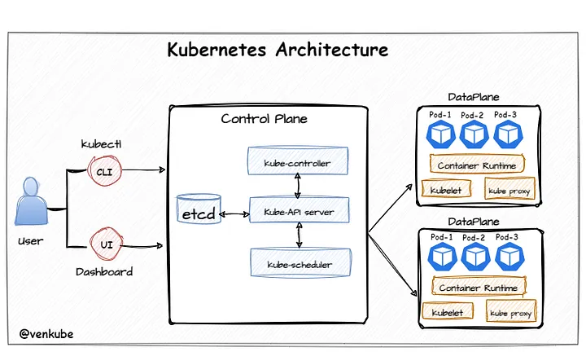

# 1. Kubernetes from the user perspective

On Day 2 you ran the climate stack with Docker Compose, on one VM. This section answers one question:

> **What does Kubernetes do for you that Compose does not, and how does it do it?**

The short answer: you **declare** the state you want, and Kubernetes keeps the cluster in that state, all the time, on many machines.

**Symbols:** ⌨️ you type the commands · 👀 the instructor shows it, you watch · 📖 reference: read it after the lesson, or when you need it; it is not covered in class.

**Slides:** the slides used in class are in one file, {download}`day03-kubernetes-slides.pdf`.

## 1.1 Kubernetes as a container orchestrator

Kubernetes is a container **orchestrator**: a system that runs and manages containers for you on a group of machines. Your application is still packaged in a container image, as on Day 2; Kubernetes decides how many containers run, on which machine, what happens when one fails, and how other programs reach them.

On one machine, `docker run` and Compose are enough: they are the right tools for tests and prototypes. A production service runs on many machines, and needs more:

- **Placement**: which machine (node) has room for this container?
- **Healing**: a container or a whole node fails; who starts a replacement, and where?
- **Updates**: a new version must replace the old one without downtime, and go back if it fails.
- **Reachability**: containers move and change IP address; clients need a stable name.

An orchestrator does all four, all the time, without you on the machines. Kubernetes is the most widely used one.

## 1.2 Why Kubernetes when you already know Docker Compose

| | Docker Compose (Day 2) | Kubernetes (today) |
|---|---|---|
| Scope | One host | A cluster of hosts (nodes) |
| Placement | You choose the host | The scheduler chooses a node |
| Healing | `restart:` on the same host | Failed Pods are replaced, also on another node |
| Updates | Stop and start | Rolling update, with rollback |
| Finding other services | Service name on the Compose network | Service name in the cluster DNS |
| HTTPS from outside | You set it up yourself | Ingress, with automatic certificates (cert-manager) |
| Many teams on one platform | Not foreseen | Namespaces, permissions (RBAC), quotas |

Use Compose to build and test a stack quickly on one machine. Use Kubernetes to run it reliably on many machines, for many users.

## 1.3 Architecture at a glance: control plane and workers



A cluster has two kinds of nodes:

- **Control plane nodes** take the decisions: they store the desired state, choose where Pods run, and run the controllers.
- **Worker nodes** do the work: they run your containers.

You talk to **one** component only: the **API server**. `kubectl` sends your YAML to it; everything else reacts to what is stored there. You never log in to a node.

### 1.3.1 📖 Control plane components

| Component | What it does |
|---|---|
| **kube-apiserver** | The front door of the cluster. Every tool, `kubectl` included, reads and writes the desired state through it |
| **etcd** | The database that stores the state of the cluster |
| **kube-scheduler** | Chooses a node for each new Pod: free resources, rules, taints |
| **kube-controller-manager** | Runs the controllers (Deployment, ReplicaSet, Node, Job…) that apply the controller loop of 1.4 |
| **cloud-controller-manager** | On a cloud: creates load balancers and follows the life of the nodes |

### 1.3.2 📖 Worker node components

| Component | What it does |
|---|---|
| **kubelet** | The agent on each node: it starts the Pods assigned to the node and runs their probes |
| **Container runtime** | Runs the containers (usually containerd): the same job as the Docker daemon on Day 2 |
| **kube-proxy** | Sets the network rules that send Service traffic to the right Pods |

### 1.3.3 📖 Add-ons you will see often

| Add-on | What it does |
|---|---|
| **CoreDNS** | The cluster DNS: Service names resolve to IP addresses |
| **Ingress controller** | Receives HTTP and HTTPS traffic from outside (on the training cluster: Traefik) |
| **CNI plugin** | Gives each Pod an IP address and connects the Pods |
| **CSI driver** | Connects the cluster to a storage system, for volumes |

## 1.4 The controller loop

The **controller loop** is the idea that explains how Kubernetes behaves. Each controller repeats these steps, without end:

1. Read the **desired state** from the API server (for example: 3 replicas).
2. Look at the **actual state** of the cluster (for example: 2 Pods run).
3. Act to remove the difference (create one Pod).
4. Start again.

```{mermaid}
flowchart LR
  D[Desired state in the API] --> C[Controller]
  A[Actual state of the cluster] --> C
  C -->|create, update, delete| A
  A -->|observed again| C
```

Read the diagram as a circle: the controller compares, acts, and compares again.

:::{note} Jargon: *declarative* and *reconciliation*
**Declarative** means that you describe the result you want ("3 replicas of this image"), not the commands to get it. **Reconciliation** is the work of the controllers: they bring the actual state back to the desired state, every time the two differ.
:::

Three consequences:

- **You change files, not servers.** To change what runs, you change the desired state; the controllers do the rest.
- **Drift is corrected.** If a Pod disappears, it comes back. If you change something by hand, the next reconciliation may undo it.
- **Changes take a moment.** There is a short delay between `kubectl apply` and the final state: `kubectl rollout status` waits for it.

Examples:

| Controller | Desired state | When it acts |
|---|---|---|
| Deployment / ReplicaSet | `replicas: 3` | Only 2 Pods run: it creates one |
| Node controller | Every node answers | A node stops answering: after about 5 minutes its Pods are evicted, and the ReplicaSet creates new ones on other nodes |
| Job | `completions: 1` | The Pod failed before finishing: it starts a new one |

## 1.5 Mental model

You never manage servers. You send **objects** to the API server, and each kind of object answers one question:

| Object | Question it answers |
|---|---|
| Workload (Deployment, StatefulSet…) | *What* runs, and how many copies? |
| Service | *How* do other programs reach it, with a stable name? |
| Ingress | *How* does traffic from outside arrive, with which hostname? |

## 1.6 Workloads you will use most

| Kubernetes resource | What it does | Example |
|---|---|---|
| **Pod** | Runs one or more containers. It is the basic unit Kubernetes deploys. | A Pod running an API |
| **Deployment** | Runs and manages interchangeable copies of an application, replacing failed Pods and updating them when needed. | API replicas, web applications (`climate-telemetry`, `climate-stats-api`) |
| **StatefulSet** | Manages Pods that need a stable identity and, often, their own persistent storage. | Database replicas such as `db-0` and `db-1` |
| **DaemonSet** | Runs a Pod on every node, or on selected nodes. | Log collectors, GPU device plugins |
| **Job** / **CronJob** | Runs a task until it finishes (Job) or runs it on a schedule (CronJob). | Data import, nightly backup |

> **Remember:** a Pod runs containers; a Deployment manages interchangeable Pods; a StatefulSet manages Pods with stable identities; a DaemonSet places Pods across nodes; a Job runs tasks to completion.

## 1.7 Services

Pods are replaced all the time, and each new Pod has a new IP address. A **Service** gives a set of Pods one stable IP address and one DNS name.

| Type | Reachable from | Typical use |
|---|---|---|
| **ClusterIP** (default) | Inside the cluster only | Almost every Service; the Ingress sends traffic to it |
| **NodePort** | A fixed port on every node | Tests, or clusters without a load balancer |
| **LoadBalancer** | An external IP address, from the cloud | One public service, without an Ingress |

## 1.8 Ingress

An **Ingress** routes HTTP and HTTPS traffic from outside to Services, by hostname and path. A request to `https://app.example.org` follows this path:

1. DNS resolves `app.example.org` to the address of the Ingress controller.
2. The Ingress controller reads the Ingress rules and chooses the Service.
3. The Service sends the request to one of its ready Pods.

## 1.9 Namespaces and RBAC

Many teams share one cluster. Two mechanisms keep them apart:

- A **namespace** is a separate space for objects: names only need to be unique inside it. On the training cluster, each of you has one, `traineeNN`.
- **RBAC** (role-based access control) says who can do what, where: you can create Deployments in `traineeNN`, but not in the namespace of your neighbour.

## 1.10 Core takeaway

> **You declare the desired state; controllers make the cluster match it, again and again.**

- Kubernetes runs containers on **many nodes**: it schedules, heals and updates them for you.
- You talk to **one** component, the API server, through `kubectl`. You never log in to a node.
- A **controller loop** compares what you asked for (`spec`) with what is true (`status`) and acts on the difference.
- **Deployment** for identical, interchangeable replicas; **StatefulSet** for one stable name and one volume per replica; **Job/CronJob** for work that ends.
- A **Service** gives Pods a stable name inside the cluster; an **Ingress** brings HTTP(S) traffic from outside.

## 1.11 📖 Check yourself

1. A Deployment has `replicas: 3`. You delete one of its Pods. What happens, and which components take part?
2. Which Kubernetes component does `kubectl` talk to? Why is that the only one you need?
3. Give two things that Kubernetes does and Docker Compose does not.
4. A database needs several replicas, each with its own volume and a stable name. Deployment or StatefulSet?
5. A Pod must call another Pod; a browser on the internet must reach your API. Which object do you need in each case?

:::{dropdown} Solutions
**1.** The ReplicaSet controller (in the controller manager) sees 2 Pods instead of 3 and creates a new one. The scheduler chooses a node for it, and the kubelet on that node starts the container. Nobody runs a command: this is the controller loop of 1.4.

**2.** The **API server**. Every tool, and every other component, reads and writes the desired state through it. The scheduler, the controllers and the kubelets react to what is stored there.

**3.** Any two of: scheduling across several nodes; replacing Pods after a node failure; rolling updates with rollback; namespaces, RBAC and quotas for many teams; an Ingress ecosystem with automatic TLS.

**4.** A **StatefulSet**: it gives each replica a stable name (`db-0`, `db-1`) and its own PVC. A single-replica database also works as a Deployment, as you will see in section 9.

**5.** Pod to Pod: a **Service** (its name resolves in the cluster DNS). Browser on the internet: an **Ingress** in front of that Service.
:::

Next: [Interacting with a cluster](02-interacting-with-a-cluster.md).
